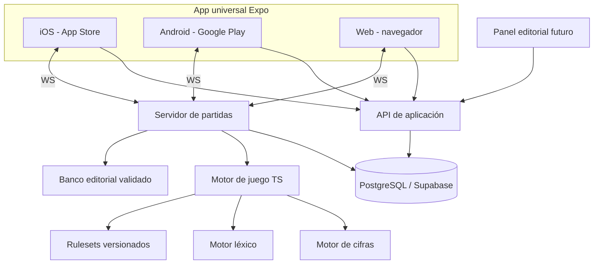

# ARCHITECTURE — Arquitectura multiplataforma del videojuego

**Versión:** 1.3 — 27/10/2026  
**Estado:** decisión técnica vigente. **Implementado (Sprint 1):** monorepo, app Expo en web, motor de cifras y sesión reproducible. Todo lo demás de este documento sigue siendo diseño; ver §4.1.  
**Decisión:** una app universal Expo/React Native para iOS, Android y web; motor de reglas TypeScript puro; servicio de partidas autoritativo; contenidos versionados y revisados editorialmente. Unity y Godot no son dependencias del MVP.

## 1. Principios de arquitectura

1. **Tres plataformas, un motor:** mismas reglas, semilla y eventos producen el mismo resultado en web, iOS y Android.
2. **Interfaz universal, variantes cuando sean necesarias:** compartir componentes RN, sin imponer que el 100 % de la UI tenga que ser idéntico.
3. **Sin lógica competitiva en cliente:** el servidor arbitra multijugador, puntuaciones, pulsaciones, vencimientos y respuestas.
4. **Modos diferenciados:** catálogo de **todos los juegos individuales como modalidad P0**, entrenamiento offline con validaciones locales y contenido embarcado; concurso completo vs IA; sesiones competitivas online con autoridad del servidor.
5. **Respuestas protegidas:** las soluciones aún no reveladas nunca viajan al cliente de una partida online.
6. **Diseño orientado a publicación:** accesibilidad, políticas de tiendas, privacidad, internacionalización y compras potenciales desde el diseño.
7. **No reinventar física o render 3D:** para pantallas de preguntas, botones, animaciones sencillas y relojes no hace falta un motor de videojuegos tradicional.
8. **Dependencia legal externa:** comercializar un formato fiel puede precisar autorización aunque se emplee marca o diseño distintos.

## 2. Stack elegido

| Capa | Tecnología | Notas |
|---|---|---|
| Aplicación universal | **Expo + React Native + TypeScript** | Una app para web, iOS y Android; versiones fijadas al inicializar el repo |
| Navegación | Expo Router | Rutas, enlaces profundos, retorno desde invitaciones |
| Render web | React Native Web | UI compartida; comprobar accesibilidad de teclado y navegador |
| Estilos | StyleSheet + tokens propios | Evitar usar shadcn/ui o CSS Tailwind web directamente en pantallas nativas |
| Animación | Reanimated cuando sea necesaria | Ajustar movimiento reducido y consumo de batería |
| Efectos | expo-audio / expo-haptics si procede | Respetar preferencias de sonido, vibración y plataforma |
| Motor de reglas | TypeScript puro + Zod | Compartido y ejecutable sin React ni API móvil |
| Backend HTTP | Node.js + TypeScript | Gestión de sesiones, contenido y perfil; framework HTTP por ADR |
| Multijugador | Node.js + WebSocket/Socket.IO | Servidor con proceso persistente y reloj autoritativo |
| Base de datos | PostgreSQL en Supabase | Guardado, perfiles, preguntas y auditoría |
| Autenticación | Supabase Auth | Invitados/anónimos primero; cuentas opcionales |
| Persistencia local | Almacén local abstraído | Entrenamiento offline; sin secretos ni recompensas competitivas locales |
| Colas | Redis/worker opcional | Añadir solo cuando exista necesidad medida |
| Builds/distribución | Expo EAS Build + EAS Submit / tiendas | Android AAB, iOS build firmado; publicación requiere cuentas y revisión |
| Pruebas | Vitest + Testing Library + Playwright web + E2E nativo | Reglas, accesibilidad, sincronización y pruebas en dispositivos |
| Observabilidad | Logs estructurados backend + crash reporting con privacidad | Telemetría sin respuestas privadas ni identificadores innecesarios |

**No introducir Next.js en el cliente del juego.** Si hace falta, crear más adelante `apps/admin-web` o `apps/marketing-web` con Next.js, aislado de la interfaz universal. Para compartir branding o reglas deben consumirse paquetes puros o contratos, no componentes DOM.

**No trasladar shadcn/ui a React Native como si fuera compatible:** usar primitives `View`, `Text`, `Pressable`, `TextInput`, `ScrollView`, `SafeAreaView` (o solución recomendada equivalente), elementos accesibles y tokens de `packages/design-tokens`. Se puede evaluar NativeWind en un ADR posterior; no es requisito del MVP.

## 3. Topología



Las reglas pueden evaluarse localmente para entrenamiento, pero la instancia del **servidor** es la única fuente de verdad de los modos competitivos. El backend no se despliega como función serverless de corta duración si necesita mantener conexiones WS.

## 3.1. Dos rutas principales, misma arquitectura

- **Ruta A (`TRAINING`)**: `/inicio → /juegos → /juegos/[prueba] → /sesion/entrenamiento → /resultado/entrenamiento`. No rival, no sala; reloj opcional; puntuación no competitiva; soluciones tras validación.
- **Ruta B (`SOLO_AI`, `LOCAL_TWO`, `PRIVATE_ONLINE`)**: `/inicio → /concurso → /partida/[id] → /resultado/concurso`. Maquinaria de fases con marcador, reloj, rival, buzzer y final; online con arbitraje servidor.
- `GameSession` referencia `mode`, `puzzleType`, `rulesetId`, `contentPackRevision` y `players`. Un `PracticeSession` reutiliza `PuzzleGenerator + RuleEngine + AnswerValidator` con modificaciones explícitas de límite temporal, sin falsas puntuaciones de concurso.
- Las **13 modalidades** se registran en un `PuzzleRegistry`; 11 habituales (incluyendo desempate) y dos especiales. En una build incompleta `available=false`, no mostrar tarjetas engañosamente jugables.
- Un solo conjunto de componentes de fichas, input y feedback: `TrainingShell` y `ContestShell` orquestan HUD distinto. Ver `UX_FLOWS.md`.
- Efectos y transiciones audiovisuales se activan sobre eventos del motor; no modifican el estado autoritativo, puntuación ni deadlines.

## 4. Monorepo previsto

```text
project-cly/
├── apps/
│   ├── game/                      # Expo Router: iOS + Android + Web
│   │   ├── app/                   # Rutas Expo Router
│   │   ├── src/components/        # UI React Native reutilizable
│   │   ├── src/features/          # Catálogo de pruebas, entrenamiento, concurso, salas, resultados
│   │   ├── src/adapters/          # Persistencia, sonido, teclado, haptics
│   │   └── app.config.ts          # App name, ids, deep links, permisos
│   ├── api/                       # Node HTTP, autenticación/autorización, contenido
│   └── realtime/                  # Node WebSocket + estado de salas
│   # apps/admin-web/              # Opcional, no construir en el Sprint 1
├── packages/
│   ├── game-engine/               # FSM, reglas, puntuación, transiciones
│   ├── numbers-engine/            # AST, cálculo y solver
│   ├── words-engine/              # Diccionario, normalización y validación
│   ├── contracts/                 # API, eventos WS, validadores Zod
│   ├── content-schemas/           # Preguntas, licencias, auditoría
│   ├── design-tokens/             # Tipografía, colores, espaciado y motion
│   ├── test-fixtures/             # Partidas y puzzles reproducibles
│   └── testing/                   # Helpers test multiplataforma
├── db/                            # SQL y migraciones PostgreSQL
├── scripts/                       # Contenido, QA y automatización
├── docs/
│   ├── ESPECIFICACION_FUNCIONAL.md
│   ├── GAME_RULES.md
│   ├── UX_FLOWS.md
│   ├── ARCHITECTURE.md
│   ├── DESIGN.md
│   ├── MOBILE_RELEASE.md
│   ├── PLAN.md
│   ├── TASKS.md
│   └── ADR/
├── CLAUDE.md
├── README.md
└── package.json
```

**Workspace:** pnpm, TypeScript estricto, CI con caché para tests y build web. Expo y dependencias nativas se instalarán con versiones compatibles mediante la herramienta oficial; no fijar números de versiones imaginarios en esta especificación.

### 4.1. Estado de implementación del monorepo (27/10/2026)

| Carpeta | Estado |
|---|---|
| `apps/game` | **Implementado.** Expo SDK 58, Expo Router, React Native Web. Verificado en web; los bundles de Android/iOS compilan, sin ejecutar en dispositivo |
| `apps/api`, `apps/realtime` | **Placeholders** de una línea; ningún servicio |
| `packages/numbers-engine` | **Implementado:** AST (`ExpressionTree`), aritmética racional exacta, validador, replay de pasos, solver, generador semillado |
| `packages/game-engine` | **Parcial:** ruleset + snapshot con hash, RNG semillado, sesiones de cifras y de letras (acciones/eventos/replay; el léxico entra como parámetro, igual que el reloj), validador y puntuación de letras, `PuzzleRegistry` (13), secuencia del concurso, progreso de entrenamiento (`practice-progress.ts`, puro, con parseo defensivo) |
| `apps/game/src/adapters` | `systemClock` (monotónico), `deviceStorage` (AsyncStorage: localStorage en web), `deviceFeedback` (vibración con `expo-haptics`; no-op en web), `newExerciseSeed`, `uiRandom` (azar solo visual), `epochNowMs`, `lexicon` (carga diferida del léxico es-ES) |
| `packages/words-engine` | **Implementado (provisional):** clasificación por fiabilidad, normalización de fichas (`toTileKey`), multiconjuntos, `parseLexicon` (búsqueda binaria y búsqueda de palabras formables) y los datos generados `data/es-ES.ts`. Falta la capa editorial `allow`/`deny` |
| `third_party/rla-es/` + `scripts/lexicon/` | Diccionario RLA-ES original (sin modificar, con huellas) y script determinista que genera el léxico (`pnpm lexicon:build`). Ver ADR-005 |
| `packages/design-tokens` | **Implementado:** color (con test de contraste), tipografía, espaciado, movimiento, breakpoints |
| `contracts`, `content-schemas`, `test-fixtures`, `testing`, `db/` | **No creados**: se crearán cuando un ticket los necesite (no hay archivos vacíos) |

Decisiones tomadas al implementar:

- **Gestor y layout:** pnpm **10.34** y `nodeLinker: hoisted`. pnpm 12 escribe un archivo de estado que supera los 260 caracteres de Windows, y el almacén aislado de pnpm 10 crea rutas que Node no resuelve en esa misma situación. Ver README «Decisiones de entorno».
- **Los paquetes se consumen como TypeScript fuente** (`main: ./src/index.ts`): sin paso de build; Metro y Vitest los transpilan.
- **Dependencia entre paquetes:** `game-engine → numbers-engine`; ninguno depende de React, Expo ni del DOM. **Lo impone ESLint** (imports, globales de navegador, `Date.now`, `Math.random`, `performance.now`, `new Date`, `eval`).
- **Zod:** diferido. El validador de cifras trabaja sobre tipos propios y rechaza estructuras mal formadas; Zod entrará con los contratos de red (CLY-050) y el parser de rulesets (CLY-011).
- **Animación:** `Animated` de React Native con `useNativeDriver` fuera de web y respeto a «reducir movimiento». Reanimated no se ha instalado (ADR-008 pendiente).
- **Tipado de rutas** (`typedRoutes`) desactivado: evita que `typecheck` dependa de archivos generados por el servidor de desarrollo.
- **Semilla y reloj** se deciden en `apps/game/src/adapters`; el motor solo recibe `nowMs` y un `RandomSource`.

## 5. Contratos del dominio

```ts
type Stage = 'KEY' | 'CLASSIC' | 'DUEL' | 'TIEBREAK' | 'FINAL';
type GameMode = 'TRAINING' | 'SOLO_AI' | 'LOCAL_TWO' | 'PRIVATE_ONLINE';
// TRAINING uses one of 13 separately selectable puzzle types; it is not a full match.
// Final configuration and registry names are defined in UX_FLOWS.md.

type GameAction =
  | { type: 'BUZZ'; matchId: string; actionId: string }
  | { type: 'SUBMIT_WORD'; matchId: string; actionId: string; word: string }
  | { type: 'SUBMIT_NUMBER'; matchId: string; actionId: string; expression: ExpressionTree }
  | { type: 'PASS'; matchId: string; actionId: string }
  | { type: 'USE_KEY'; matchId: string; actionId: string }
  | { type: 'PLAYER_READY'; matchId: string; actionId: string };

type GameEvent =
  | { type: 'STAGE_STARTED'; stage: Stage; deadlineEpochMs: number }
  | { type: 'BUZZ_WON'; playerId: string }
  | { type: 'ANSWER_VALIDATED'; playerId: string; accepted: boolean }
  | { type: 'SCORE_AWARDED'; playerId: string; points: number; reason: string }
  | { type: 'STAGE_FINISHED'; stage: Stage };

interface RuleEngine {
  apply(state: GameState, action: ValidatedAction, nowMs: number): ApplyResult;
  viewFor(state: GameState, playerId: string): PublicGameView;
  replay(initial: GameState, events: GameEvent[]): GameState;
}
```

El motor es agnóstico a React Native, Expo, Unity o cualquier renderer. Tiempo, RNG y latencia son parámetros inyectados. Una acción recibida se asocia al usuario autenticado en servidor, no a un `playerId` arbitrario recibido del cliente.

## 6. Persistencia propuesta

| Tabla | Datos relevantes | Uso |
|---|---|---|
| `users` | id, authId, createdAt | Identidad mínima |
| `player_profiles` | userId, alias, preferences | Preferencias y privacidad |
| `rulesets` | version, revision, checksum, json | Histórico de reglas |
| `content_packs` | revision, locale, status, license | Material editorial |
| `puzzles` | type, difficulty, publicPayload, privateAnswers | Puzzle con solución protegida |
| `matches` | id, mode, ruleset, seed, status | Partida |
| `match_players` | matchId, playerId, seat, score | Jugadores |
| `match_events` | sequence, time, kind, payload | Replay y auditoría |
| `match_results` | winner, stats, rewardVirtual | Resultado |
| `lobbies` | codeHash, expiry, status | Invitaciones privadas |
| `editorial_reviews` | puzzleId, reviewer, decision | Control de calidad |
| `audit_logs` | actor, action, time | Administración |

Acceso con RLS/servidor según tipo de dato. No distribuir claves de administración en app móvil, ni publicar las soluciones completas del pack online. La versión offline empaqueta solamente un conjunto destinado expresamente a entrenamiento no competitivo.

## 7. Cifras, letras y contenidos

**Cifras:** AST con fichas identificadas por `tileId`, operadores autorizados por ruleset, divisiones/intermedios controlados, solver por subconjuntos, generación semillada, tests property-based y **prohibición de `eval`**.

**Letras:** normalización Unicode y reglas explícitas para Ñ, tilde, vocales, morfología y multiconjuntos; lexicón redistribuible con licencia verificada y excepciones editoriales. Un corrector ortográfico no equivale automáticamente al criterio lingüístico de RTVE.

**Editorial:** creación `DRAFT -> AUTO_CHECKED -> REVIEWED -> PUBLISHED -> RETIRED`; tests de ambigüedad; banco de contenido con derechos trazables. La IA no redacta respuestas improvisadas en competición.

## 8. Tiempo real, pulsadores y desconexiones

- Cada sala tiene `matchId`, estado reproducible, `rulesetId`, número de secuencia y vencimientos absolutos del servidor.
- Acciones con `actionId` idempotente, serialización por partida y validación de permisos; evitar duplicados por reconexión.
- Pulsador: criterio determinista de primera **recepción válida en servidor** con telemetría de latencia; evaluar políticas de equidad antes del ranking.
- Al reconectar, enviar snapshot **público** filtrado y eventos posteriores, nunca respuestas futuras.
- El cliente muestra una cuenta atrás aproximada, pero no puede ampliar el tiempo modificando el reloj local.
- Android/iOS en segundo plano pueden suspender redes y temporizadores: mostrar aviso, reanudar y sincronizar con servidor, no prometer continuidad perfecta mientras app está cerrada.
- Entrenamiento offline: reloj y progreso local; nunca subir después una supuesta puntuación competitiva firmada por el cliente.

## 9. IA rival

`BotPolicy.chooseAction(visibleState, difficulty, rng)` sin información privilegiada. Niveles ajustables mediante rapidez, tasa de aciertos, elecciones de palabras y fallos plausibles; 100+ partidas simuladas por nivel antes de calibrar.

## 10. Pruebas y calidad multiplataforma

| Nivel | Objetivo | Herramientas previstas |
|---|---|---|
| Dominio | Reglas, solver, determinismo | Vitest + property based |
| UI universal | Comportamiento y accesibilidad | React Native Testing Library |
| Web | Navegación, teclado, responsive | Playwright |
| Android | Entrenamiento, input, foreground/background, salas | E2E nativo (Maestro o Detox a decidir) |
| iOS | TestFlight, safe areas, input, navegación, salas | E2E nativo o dispositivo real |
| Servidor | Acceso, concurrencia, rate limits, clock | Tests de integración y carga |
| Distribución | Binary instalable, firma, permisos y stores | EAS Build + revisión manual |

**Gates CI:** lint + typecheck + unit en cada PR; build web frecuente; builds de desarrollo Android/iOS al inicio y periódicamente; pruebas de dispositivos reales antes de beta. La versión web no sustituye a probar builds nativos.

## 11. Publicación, privacidad y pagos

- **Android:** AAB firmado, app id estable, pruebas internas/cerradas, ficha de Google Play y declaración de datos.
- **iOS:** build iOS firmado, TestFlight, cuenta Apple Developer, políticas de privacidad, revisión App Store.
- Borrado de cuenta, consentimiento/política de privacidad, clasificación de edad y datos de menores se evaluarán antes de publicación.
- Si se venden bienes digitales dentro de las apps, analizar reglas vigentes de compras integradas por tienda y mercado. No presuponer Stripe como único mecanismo para vender ventajas digitales dentro de apps.
- Mantener ruta de publicación legalmente bloqueada mientras la réplica exacta del formato no tenga autorización o análisis jurídico favorable.
- `docs/MOBILE_RELEASE.md` mantiene el checklist de tienda y el gate comercial.

## 12. ADR

- `ADR-001`: ORM/SQL y Supabase.
- `ADR-002`: autenticación (Supabase Auth elegido provisionalmente).
- `ADR-003`: Socket.IO versus WebSocket nativo.
- `ADR-004`: reglas versionadas y evidencia del formato.
- `ADR-005`: léxico y su licencia — **aceptada provisionalmente** (`ADR/ADR-005-LEXICO.md`): RLA-ES/Hunspell bajo MPL 1.1.
- `ADR-006`: identidad, licencia y protección del formato.
- **`ADR-007`: Expo/React Native versus Unity/Godot (decisión vigente).**
- `ADR-008` (pendiente): estilo e implementación de animaciones, NativeWind versus StyleSheet.
- `ADR-009` (pendiente): QA nativo Maestro versus Detox.

## 13. Referencias técnicas

- Expo Router (iOS, Android y web): https://docs.expo.dev/router/introduction/
- Expo Web: https://docs.expo.dev/workflow/web/
- EAS Build: https://docs.expo.dev/build/setup/
- Unity requisitos y plataformas: https://docs.unity3d.com/6000.0/Documentation/Manual/system-requirements.html
- Godot plataformas: https://docs.godotengine.org/en/stable/about/faq.html
